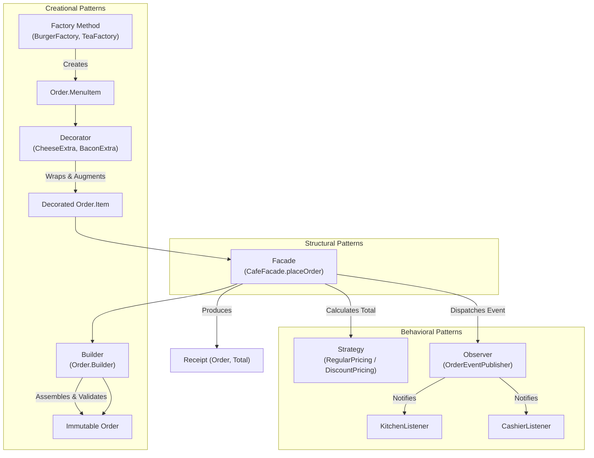

# Project Defense Report: Cafe Ordering System
**Course:** Software Design Patterns / Object-Oriented Software Engineering  
**Language & Runtime:** Java 17  
**Repository:** [Jasulankoishy/Cafe-Final-Project](https://github.com/Jasulankoishy/Cafe-Final-Project)  

---

## 1. Introductory Part

### 1.1 Project Overview & Motivation
In modern food service and hospitality operations, restaurant management systems must handle complex, dynamically changing requirements:
- Menu items vary across categories (burgers, drinks, sides).
- Customers routinely customize orders with additional toppings, sauces, and extras.
- Pricing policies change based on promotions, member discounts, or seasonal campaigns.
- Multiple downstream departments (kitchen prep, cashier invoicing, order tracking) must be kept synchronized without tightly coupling their internal logic to the ordering engine.

The **Cafe Ordering System** is designed to address these requirements using clean object-oriented architecture. Rather than relying on monolithic procedural code or rigid class hierarchies, the project integrates **six classic GoF (Gang of Four) design patterns** into a unified, cohesive framework.

### 1.2 Team Allocation & Pattern Ownership
In compliance with the course requirements (each student individually implementing at least two design patterns, with at least six patterns collectively integrated):

| Student | Assigned Patterns | Pattern Categories | Core Responsibilities |
| :--- | :--- | :--- | :--- |
| **Jasulan Koishybay** | **Builder**, **Facade** | Creational, Structural | Designed order structure with immutable records and validation; provided a unified facade coordinating order intake, pricing, and notification dispatch. |
| **Dias (HumbleCherry10)** | **Strategy**, **Observer** | Behavioral, Behavioral | Implemented flexible pricing algorithms (regular and percentage discount with overflow protection); implemented event publisher and department listeners (Kitchen, Cashier). |
| **Adilet Ainadinov** | **Factory Method**, **Decorator** | Creational, Structural | Created factory hierarchies for menu item creation; built dynamic decorator wrappers for custom toppings and price adjustments. |

---

## 2. System Architecture & High-Level Design

### 2.1 Coordinated Workflow Diagram
All six design patterns collaborate during the lifecycle of an order:



### 2.2 Complete Class Diagram

```mermaid
classDiagram
    %% Core Interfaces & Records
    class Item {
        <<interface>>
        +name() String
        +price() int
    }

    class MenuItem {
        -String name
        -int price
        +name() String
        +price() int
    }
    Item <|.. MenuItem

    class Order {
        -String customer
        -List~Item~ items
        +customer() String
        +items() List~Item~
    }

    class Builder {
        -String customer
        -List~Item~ items
        +Builder(String customer)
        +add(Item item) Builder
        +build() Order
    }
    Order +-- Builder

    %% Factory Method
    class MenuItemFactory {
        <<abstract>>
        +createItem()* Item
    }
    class BurgerFactory {
        -String name
        -int price
        +createItem() Item
    }
    class TeaFactory {
        -String name
        -int price
        +createItem() Item
    }
    MenuItemFactory <|-- BurgerFactory
    MenuItemFactory <|-- TeaFactory
    BurgerFactory ..> MenuItem : creates
    TeaFactory ..> MenuItem : creates

    %% Decorator
    class ItemDecorator {
        <<abstract>>
        #Item wrapped
        +ItemDecorator(Item wrapped)
        +name() String
        +price() int
    }
    class CheeseExtra {
        -int extraPrice
        +name() String
        +price() int
    }
    class BaconExtra {
        -int extraPrice
        +name() String
        +price() int
    }
    Item <|.. ItemDecorator
    ItemDecorator <|-- CheeseExtra
    ItemDecorator <|-- BaconExtra
    ItemDecorator o--> Item : wraps

    %% Facade
    class CafeFacade {
        -Pricing pricing
        -OrderEvents events
        +CafeFacade(Pricing pricing, OrderEvents events)
        +placeOrder(String customer, List~Item~ items) Receipt
    }

    %% Strategy
    class Pricing {
        <<interface>>
        +total(Order order) int
    }
    class RegularPricing {
        +total(Order order) int
    }
    class DiscountPricing {
        -int discountPercent
        +total(Order order) int
    }
    Pricing <|.. RegularPricing
    Pricing <|.. DiscountPricing
    CafeFacade --> Pricing

    %% Observer
    class OrderEvents {
        <<interface>>
        +placed(Order order, int total)
    }
    class OrderEventPublisher {
        -List~OrderEvents~ listeners
        +subscribe(OrderEvents listener)
        +placed(Order order, int total)
    }
    class KitchenListener {
        +placed(Order order, int total)
    }
    class CashierListener {
        +placed(Order order, int total)
    }
    OrderEvents <|.. OrderEventPublisher
    OrderEvents <|.. KitchenListener
    OrderEvents <|.. CashierListener
    CafeFacade --> OrderEvents
    OrderEventPublisher o--> OrderEvents : notifies
```

---

## 3. Body Part: Detailed Implementation of Design Patterns

### 3.1 Pattern 1: Builder Pattern (Creational)
- **Implemented by:** Jasulan Koishybay
- **Key Class:** `cafe.Order.Builder`
- **Intent:** Separate the construction of a complex `Order` object from its representation, allowing sequential step-by-step assembly with strict invariants.

#### Implementation Details:
The `Order` is modeled as a Java 17 `record` containing a customer name and an immutable copy of item elements (`List.copyOf(items)`). `Order.Builder` enforces mandatory validation:
1. The customer name must not be `null` or blank.
2. Individual items cannot be `null`.
3. An order cannot be built without at least one item.

```java
public static class Builder {
    private final String customer;
    private final List<Item> items = new ArrayList<>();

    public Builder(String customer) {
        if (customer == null || customer.isBlank()) {
            throw new IllegalArgumentException("Customer name is required.");
        }
        this.customer = customer;
    }

    public Builder add(Item item) {
        items.add(java.util.Objects.requireNonNull(item));
        return this;
    }

    public Order build() {
        if (items.isEmpty()) {
            throw new IllegalStateException("Add at least one item.");
        }
        return new Order(customer, items);
    }
}
```

---

### 3.2 Pattern 2: Facade Pattern (Structural)
- **Implemented by:** Jasulan Koishybay
- **Key Class:** `cafe.CafeFacade`
- **Intent:** Provide a unified, simplified interface to a complex subsystem composed of ordering, pricing algorithms, receipt generation, and multi-observer notifications.

#### Implementation Details:
Clients interact with a single method: `placeOrder(String customer, List<Order.Item> items)`. The facade encapsulates the entire lifecycle:
1. Calls `Order.Builder` to assemble and validate the order.
2. Invokes the injected `Pricing` strategy to calculate the total bill.
3. Packages the result into an immutable `CafeFacade.Receipt`.
4. Dispatches the order placement event to `OrderEvents`.
5. Returns the completed receipt to the client.

```java
public Receipt placeOrder(String customer, List<Order.Item> items) {
    Order.Builder builder = new Order.Builder(customer);
    items.forEach(builder::add);
    Order order = builder.build();
    int total = pricing.total(order);
    Receipt receipt = new Receipt(order, total);
    events.placed(order, total);
    return receipt;
}
```

---

### 3.3 Pattern 3: Factory Method Pattern (Creational)
- **Implemented by:** Adilet Ainadinov
- **Key Classes:** `MenuItemFactory`, `BurgerFactory`, `TeaFactory`
- **Intent:** Define an interface for creating an object, but let subclasses decide which class to instantiate.

#### Implementation Details:
`MenuItemFactory` defines the abstract method `createItem()`, returning the `Order.Item` interface. Concrete creators (`BurgerFactory`, `TeaFactory`) instantiate standard products with default configurations while allowing customized names or base prices.

```java
public abstract class MenuItemFactory {
    public abstract Order.Item createItem();
}

public class BurgerFactory extends MenuItemFactory {
    private final String name;
    private final int price;

    public BurgerFactory() { this("Burger", 1500); }
    public BurgerFactory(String name, int price) {
        if (price < 0) throw new IllegalArgumentException("Price cannot be negative.");
        this.name = Objects.requireNonNull(name, "Name cannot be null.");
        this.price = price;
    }

    @Override
    public Order.Item createItem() {
        return new Order.MenuItem(name, price);
    }
}
```

---

### 3.4 Pattern 4: Decorator Pattern (Structural)
- **Implemented by:** Adilet Ainadinov
- **Key Classes:** `ItemDecorator`, `CheeseExtra`, `BaconExtra`
- **Intent:** Attach additional responsibilities (toppings and price adjustments) to an item dynamically without altering the underlying class or relying on class explosion.

#### Implementation Details:
`ItemDecorator` implements `Order.Item` and wraps another `Order.Item`. Concrete decorators such as `CheeseExtra` (+200 KZT) and `BaconExtra` (+300 KZT) override `name()` and `price()` to augment behavior, chaining seamlessly:

```java
public abstract class ItemDecorator implements Order.Item {
    protected final Order.Item wrapped;

    public ItemDecorator(Order.Item wrapped) {
        this.wrapped = Objects.requireNonNull(wrapped, "Wrapped item must not be null.");
    }
    @Override public String name() { return wrapped.name(); }
    @Override public int price() { return wrapped.price(); }
}

public final class CheeseExtra extends ItemDecorator {
    private final int extraPrice;
    public CheeseExtra(Order.Item wrapped) { this(wrapped, 200); }
    public CheeseExtra(Order.Item wrapped, int extraPrice) {
        super(wrapped);
        this.extraPrice = extraPrice;
    }
    @Override public String name() { return wrapped.name() + " + Cheese"; }
    @Override public int price() { return Math.addExact(wrapped.price(), extraPrice); }
}
```

---

### 3.5 Pattern 5: Strategy Pattern (Behavioral)
- **Implemented by:** Dias (HumbleCherry10)
- **Key Classes:** `CafeFacade.Pricing`, `RegularPricing`, `DiscountPricing`
- **Intent:** Define a family of pricing algorithms, encapsulate each one, and make them interchangeable at runtime.

#### Implementation Details:
The `CafeFacade.Pricing` interface requires a `total(Order order)` method:
- `RegularPricing`: Computes standard subtotal.
- `DiscountPricing`: Accepts a percentage discount ($0\% \le d \le 100\%$), computes the discounted price using `long` arithmetic, rounds down to integer KZT (`Math.floorDiv`), and uses `Math.multiplyExact` to guard against integer overflow.

```java
public final class DiscountPricing implements CafeFacade.Pricing {
    private final int discountPercent;

    public DiscountPricing(int discountPercent) {
        if (discountPercent < 0 || discountPercent > 100) {
            throw new IllegalArgumentException("Discount must be between 0 and 100 percent.");
        }
        this.discountPercent = discountPercent;
    }

    @Override
    public int total(Order order) {
        long subtotal = order.items().stream().mapToLong(Order.Item::price).sum();
        long discounted = Math.floorDiv(Math.multiplyExact(subtotal, 100 - discountPercent), 100);
        return Math.toIntExact(discounted);
    }
}
```

---

### 3.6 Pattern 6: Observer Pattern (Behavioral)
- **Implemented by:** Dias (HumbleCherry10)
- **Key Classes:** `CafeFacade.OrderEvents`, `OrderEventPublisher`, `KitchenListener`, `CashierListener`
- **Intent:** Define a one-to-many dependency between an event source and interested observers so that when an order is placed, all subscribed entities are automatically notified.

#### Implementation Details:
`OrderEventPublisher` maintains a list of `CafeFacade.OrderEvents` subscribers. When `placed(order, total)` is called, a snapshot of listeners (`List.copyOf(listeners)`) is iterated over, notifying each synchronously and preventing concurrent modification anomalies.
- `KitchenListener`: Prints the customer name and the list of item names to prepare.
- `CashierListener`: Prints the customer name and the exact total amount due.

```java
public final class OrderEventPublisher implements CafeFacade.OrderEvents {
    private final List<CafeFacade.OrderEvents> listeners = new ArrayList<>();

    public void subscribe(CafeFacade.OrderEvents listener) {
        listeners.add(Objects.requireNonNull(listener, "Listener is required."));
    }

    @Override
    public void placed(Order order, int total) {
        for (CafeFacade.OrderEvents listener : List.copyOf(listeners)) {
            listener.placed(order, total);
        }
    }
}
```

---

## 4. SOLID & Clean Code Principles Adherence

| Principle | How It Is Achieved in the Cafe System |
| :--- | :--- |
| **Single Responsibility (SRP)** | Each class encapsulates one concern: `Order.Builder` handles construction; `DiscountPricing` computes discounts; `KitchenListener` processes kitchen alerts; `CafeFacade` coordinates workflows. |
| **Open/Closed (OCP)** | New menu items, toppings, pricing strategies, or event listeners can be added without modifying existing core classes (`Order`, `CafeFacade`, `ItemDecorator`). |
| **Liskov Substitution (LSP)** | Any `ItemDecorator` (e.g. `CheeseExtra`, `BaconExtra`) can be used anywhere an `Order.Item` is expected without breaking contracts or side effects. Similarly, `DiscountPricing` cleanly substitutes `RegularPricing`. |
| **Interface Segregation (ISP)** | Granular, focused functional interfaces (`Item`, `Pricing`, `OrderEvents`) rather than a bloated monolithic interface. |
| **Dependency Inversion (DIP)** | High-level modules like `CafeFacade` depend upon abstractions (`Pricing`, `OrderEvents`) rather than concrete implementations (`RegularPricing`, `OrderEventPublisher`). |

---

## 5. Execution Walkthrough & Verification

### 5.1 Compilation Command
```sh
javac --release 17 -d out src/cafe/*.java
```

### 5.2 Main Application Output (`cafe.Main`)
```text
==================================================
     CAFE ORDERING SYSTEM - DESIGN PATTERNS DEMO  
==================================================

[1. Factory Method]
Created base item: Burger (1500 KZT)
Created base item: Tea (500 KZT)

[2. Decorator]
Decorated item: Burger + Cheese + Bacon (2000 KZT)

[3. Observer]
Subscribed KitchenListener and CashierListener to OrderEventPublisher.

[4. Strategy & Facade]
Initialized CafeFacade with 10% DiscountPricing and event publisher.

[5. Placing Order via Facade]
Kitchen: prepare order for Zhasulan: Burger + Cheese + Bacon, Tea
Cashier: order for Zhasulan, total: 2250 KZT

[6. Customer Receipt]
Customer: Zhasulan
 - Burger + Cheese + Bacon         2000 KZT
 - Tea                              500 KZT
--------------------------------------------------
Final Total (after discount):           2250 KZT
==================================================
```

### 5.3 Automated Verification Suites

1. **Integration Checks (`cafe.IntegrationChecks`):**
   ```text
   All integrated system checks passed.
   ```
2. **Member 1 Menu & Decorator Checks (`cafe.MenuPatternsChecks`):**
   ```text
   All menu and decorator checks passed.
   ```
3. **Member 2 Pricing & Observer Checks (`cafe.PricingEventsChecks`):**
   ```text
   All pricing and event checks passed.
   ```

---

## 6. Conclusion & Further Work

### 6.1 Conclusion
The Cafe Ordering System successfully implements **six distinct software design patterns** in Java 17 under a collaborative team workflow:
- **Creational:** Builder, Factory Method
- **Structural:** Facade, Decorator
- **Behavioral:** Strategy, Observer

All components are decoupled, modular, testable, and adhere to SOLID principles. The system cleanly demonstrates both independent pattern operation and end-to-end coordinated execution.

### 6.2 Further Work
- **Adapter Pattern:** Integrate external third-party payment gateways (e.g. Kaspi Pay, Stripe, PayPal) using the Adapter pattern to standardize payment processing.
- **Repository Pattern & Persistence:** Add a database layer (PostgreSQL or SQLite) via the Repository pattern to persist order receipts and historical analytics.
- **Command Pattern:** Implement undo/redo functionality for customer order editing before submission.
- **Graphical / Web Interface:** Build a modern UI (JavaFX or Spring Boot REST + React) to visualize real-time kitchen and cashier status updates.
